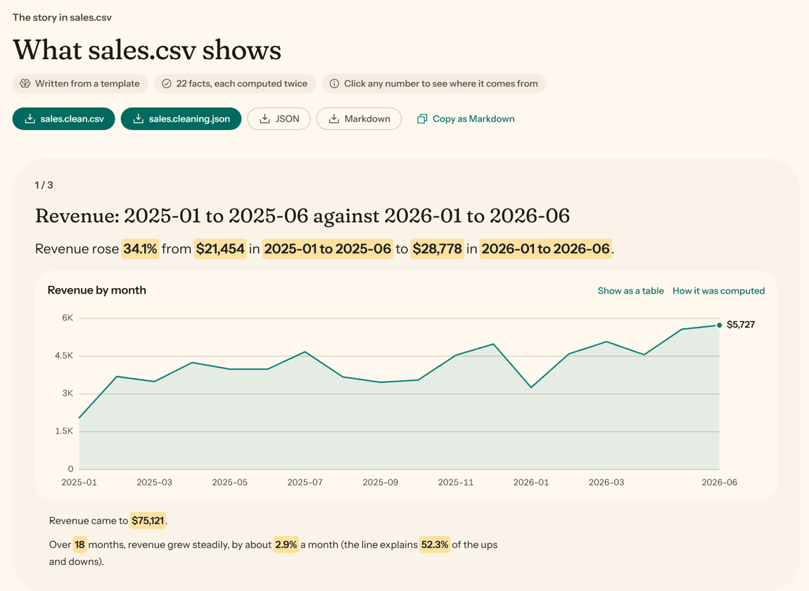

<p align="center">
  
</p>

<h1 align="center">margin</h1>

<p align="center"><b>AI agents that show their work.</b></p>

<p align="center">
  <a href="https://pypi.org/project/margin-cli/"></a>
  <a href="https://github.com/Waddah0-0/margin/actions/workflows/ci.yml"></a>
  
  <a href="LICENSE"></a>
</p>

<p align="center">
  <a href="#try-it">Try it</a> ·
  <a href="#agents">Agents</a> ·
  <a href="#ways-to-run-it">Ways to run it</a> ·
  <a href="#models">Models</a> ·
  <a href="#write-your-own-agent">Write your own</a>
</p>

Most AI tools hand you a confident paragraph and hope for the best. margin's agents hand you
the answer and the receipts: the line of code, the commit or the row of data behind it. Think
of notes written in the margin of your work, which is where the name comes from.

Each agent does one job. They run on your own computer, with a local model or with no model at
all, so there's no API key to find and no bill at the end of the month.

## Try it

Here's a small, messy spreadsheet export. It has a title row where the headers should be, two
date formats, a repeated row and a revenue cell that says `n/a`:

```text
Monthly sales export,,,
Order date,Region,Revenue,Customer email
2026-01-05,North,"$1,200.50",a@example.com
05/02/2026,north,"$980",b@example.com
2026-03-07,South,"$1,450",c@example.com
2026-03-07,South,"$1,450",c@example.com
2026-04-11,South,n/a,d@example.com
2026-05-19,North,"$2,100",e@example.com
```

Give it to the Data Storyteller:

```bash
pip install margin-cli margin-data-storyteller
curl -O https://raw.githubusercontent.com/Waddah0-0/margin/main/examples/sales.csv
margin run data-storyteller sales.csv --set assume_defaults=true
```

It cleans the file and accounts for every change. Part of the report:

```markdown
Cleaned sales.csv: 5 rows and 4 columns. 5 changes, 1 row removed; every value is accounted
for. 3 decisions were assumed, not confirmed.

### Order date: read as dates

Read 1 value as dates (month first).

- **decision** `In "Order date", is 05/02/2026 day first or month first?` - Assumed, not confirmed: Month first
- **change** `row 4` - 05/02/2026 → 2026-05-02

### Revenue: values that mean empty

Emptied 1 cell that means no value ("n/a" ×1).

- **change** `row 7` - n/a → empty
```

Is 05/02/2026 in May or February? The file can't say. Leave out `assume_defaults` and margin
asks you. Keep it, as above, and the guess is labelled as a guess.

Add `--set stop_after=story` to a bigger file and it finds the story too. In the web UI every
number is a button that opens the fact behind it:

<p align="center">
  
  <br />
  <sub>600 rows of made-up sales data, with the story written from the built-in template and no model.</sub>
</p>

## Agents

| Agent | What it does | State |
|---|---|---|
| [Data Storyteller](agents/data_storyteller/README.md) | Cleans a table of data, explains every change, and writes the story in it, every number checked. | Experimental |
| [AI Code Detector](agents/ai_code_detector/README.md) | Estimates how likely a codebase was written with AI assistance, and shows the evidence. | Experimental |
| [Echo](agents/echo/README.md) | Repeats what you tell it. It's here for testing, and for copying when you write your own. | Ready |

Each one installs separately, and every margin tool finds whatever you've installed. Point the
detector at a repository and it gives you a range, a confidence level and the files and lines
that moved the number:

```bash
pip install margin-cli margin-ai-code-detector
margin run ai-code-detector https://github.com/psf/requests
```

Its estimate is good for ranking, and it's no proof of anything, so please don't accuse anyone
based on it. [How it scores](docs/methodology.md) has the measurements.

## Why you can check its work

- **Code computes the numbers.** A model never makes one up. The storyteller's writer can only
  refer to facts by name, and each fact is computed twice, in pandas and in separate SQL. If
  they disagree, the run fails. The detector's model points at line numbers, and margin copies
  the quotes from the file.
- **You make the judgement calls.** An agent can stop and ask instead of guessing. Every answer
  stays in the result, marked with who gave it.
- **Strange repositories stay inert.** They're read and never run, and git is locked down so a
  repository can't make it start a program. [The security page](docs/security.md) lists each
  protection and its limits.
- **Your data stays on your computer** with the default local model. If you choose a hosted one,
  the UI tells you. The storyteller never sends it a row of data.

## Ways to run it

**In the terminal**

```bash
margin list                  # what's installed
margin info data-storyteller # what it takes as input
margin run data-storyteller sales.csv --format json --out report.json
```

Reports go to stdout and everything else to stderr, so output is safe to pipe.
[The CLI's README](packages/cli/README.md) has every option and exit code.

**In the browser**

```bash
pip install margin-api
margin-api                   # then open http://127.0.0.1:8000
```

You get a form for each agent, live progress and downloadable results. The same server is an
HTTP API for your own programs, documented at `/docs` ([details](packages/api/README.md)).

**With Docker**

```bash
docker compose up            # then open http://localhost:8000
```

This runs from a clone of this repository. The API and web UI share one container, which uses
the Ollama already running on your computer.

<details>
<summary>Docker details</summary>

The folder you start it from is shared read-only at `/workspace`, so to check a local project,
point the detector at `/workspace/...`. Set `MARGIN_WORKSPACE` to share a different folder.
GitHub URLs need nothing extra.

Settings and keys live in a Docker volume and survive rebuilds. The container only listens on
your computer and doesn't run as root. `compose.yaml` has the other options, including Ollama
in Docker on Linux with an NVIDIA GPU.

</details>

**From Python**

```python
import asyncio
from margin_core import run_agent


async def main() -> None:
    result = await run_agent("echo", {"message": "hello", "repeat": 2})
    print(result.summary)  # Echoed 11 characters (2x).


asyncio.run(main())
```

## Models

By default, agents use [Ollama](https://ollama.com) on your computer with `qwen3.5:9b`, which
fits on an 8 GB GPU. It beat the other small models we tried at judging code on the same files.

```bash
ollama pull qwen3.5:9b
```

Local models are slower and less sharp than the big hosted ones. If that matters for a run,
pick Anthropic or OpenAI on the web UI's Settings page, or use `--provider` and `--model` on the
command line. Prompts then go to that company. For the detector, that includes samples of the
code it reads.

<details>
<summary>Other local servers, and settings</summary>

Any server that speaks the OpenAI chat API works. Set `LOCAL_LLM_BASE_URL`:

| Server | `LOCAL_LLM_BASE_URL` |
|---|---|
| Ollama (default) | `http://localhost:11434` |
| LM Studio | `http://localhost:1234` |
| llama.cpp `llama-server` | `http://localhost:8080` |
| vLLM | `http://localhost:8000` |

For long inputs, give Ollama a larger context window, for example `OLLAMA_CONTEXT_LENGTH=8192`.

Change settings with environment variables, the web UI's Settings page, or a copy of
`.env.example` named by `MARGIN_ENV_FILE`. A `.env` in the current folder is not read, because
that folder may be a repository you're analysing.

</details>

## Write your own agent

An agent is a class with an input, an output and a `run` method. This one counts TODOs and says
where it found them:

```python
from margin_core import AgentInput, AgentResult, BaseAgent, Evidence, Finding, RunContext
from pydantic import BaseModel


class TodoInput(AgentInput):
    text: str


class TodoOutput(BaseModel):
    todos: int


class TodoCounter(BaseAgent):
    id = "todo-counter"
    name = "TODO Counter"
    description = "Counts the TODOs in a piece of text."
    version = "0.1.0"
    InputModel = TodoInput
    OutputModel = TodoOutput

    async def run(self, input: TodoInput, ctx: RunContext) -> AgentResult:
        lines = enumerate(input.text.splitlines(), start=1)
        hits = [(number, line) for number, line in lines if "TODO" in line]
        return self.make_result(
            summary=f"Found {len(hits)} TODOs.",
            output=TodoOutput(todos=len(hits)),
            findings=[
                Finding(
                    title="TODOs",
                    summary="Lines that still have work to do.",
                    evidence=[
                        Evidence(kind="line", location=str(number), detail=line)
                        for number, line in hits
                    ],
                )
            ],
        )
```

Once it's registered, the CLI, the API and the web UI all pick it up, and the form comes from
the input model. You don't edit anything else. Loading repositories, retrying model calls,
tracking cost and writing reports are already handled by the core.

To start a real one inside this repository:

```bash
uv run python scripts/new_agent.py todo-counter --name "TODO Counter" \
    --description "Counts the TODOs in a piece of text."
uv sync --all-packages
```

[Writing an agent](docs/writing-an-agent.md) walks through the rest, and
`examples/custom_agent.py` is a complete script you can run.

## How it fits together

```
                        web UI
                          |
        CLI            HTTP API          Python code
          \               |                  /
           +-------- agent registry --------+
                          |
                     agent.run(input)
                          |
         +----------------+----------------+
         |                |                |
      loaders         LLM client       reporting
  (GitHub, local)  (local, hosted,   (JSON, Markdown)
                       mock)
```

<details>
<summary>What's in this repository</summary>

| Path | What it is |
|---|---|
| [`packages/core`](packages/core/README.md) | The agent contract, result models, registry, loaders, LLM clients and reports. |
| [`packages/cli`](packages/cli/README.md) | The `margin` command. |
| [`packages/api`](packages/api/README.md) | The HTTP server: background runs, live progress, questions, uploads. |
| [`ui/`](ui/README.md) | The web UI, a client of the API ([design rules](ui/DESIGN.md)). |
| `agents/` | One folder per agent, each a self-contained package. |
| `examples/` | A runnable script and the sample file above. |
| `scripts/` | Workspace tools: create and check agents, mirror them, type-check, build a release. |
| `docs/` | [Writing an agent](docs/writing-an-agent.md), [methodology](docs/methodology.md), [security](docs/security.md) and [releasing](docs/releasing.md). |

</details>

## Development

You need Python 3.11 or newer, [uv](https://github.com/astral-sh/uv) and git, plus Node 20 or
newer for the web UI.

```bash
git clone https://github.com/Waddah0-0/margin.git
cd margin
uv sync --all-packages
uv run margin list
```

To work on the UI, start the API so it accepts the dev server, then start that:

```bash
MARGIN_API_CORS_ORIGINS='["http://localhost:3000"]' uv run margin-api
cd ui && npm install && npm run dev    # http://localhost:3000
```

Run these before you commit. CI runs the same ones.

```bash
uv run ruff check .
uv run ruff format --check .
uv run python scripts/typecheck.py
uv run python -m pytest              # no network needed

cd ui && npx biome check . && npm run typecheck && npm test
```

Found a bug? [Open an issue](https://github.com/Waddah0-0/margin/issues). For anything that
could put users at risk, please use GitHub's private vulnerability reporting.

## License

[MIT](LICENSE)
